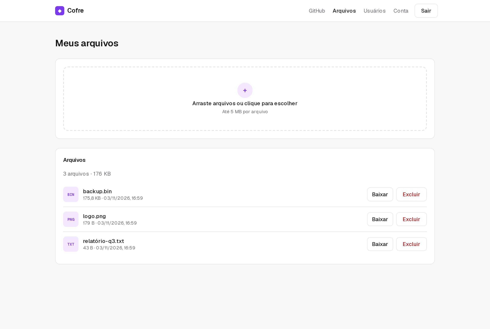
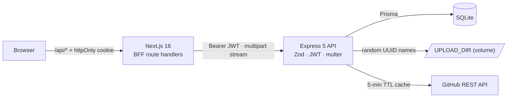
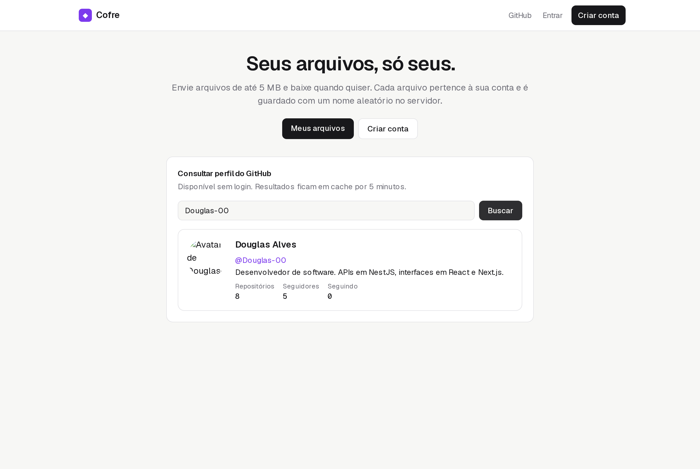
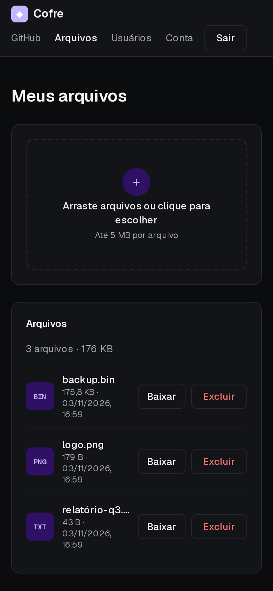

# Cofre — users, JWT auth, private file storage and GitHub lookup

[](https://github.com/Douglas-00/ApiRest/actions/workflows/ci.yml)

> 🇧🇷 [Leia em português](README.pt-BR.md)

A plain **Express 5** + Prisma API (no framework magic), with a Next.js frontend. Users sign up, upload files up to 5 MB, download them later, and look up GitHub profiles.

This was my first REST API (2023). I kept the original scope and **rewrote it to the standard I'd ship today**. The list below covers what was wrong and how it was fixed.



## What was wrong in the 2023 version

| Problem | Impact | Fix |
| --- | --- | --- |
| JWT signed with the hard-coded string `"secret"` | Anyone could forge tokens | `JWT_SECRET` from env, ≥16 chars, validated at startup |
| `PUT` / `DELETE /users/id/:id` had **no authentication** | Anyone could edit or delete any user | Replaced by `/users/me` behind JWT |
| Sign-up returned the full user **including the password hash** | Hash leaked to the client | Explicit `select` of public fields |
| Login said "user not found" vs "invalid password" | E-mail enumeration | Same 401 message; bcrypt runs against a dummy hash so both paths take similar time |
| Download looked in a different folder than upload | **Downloads always failed** | Single `UPLOAD_DIR`, tested byte-for-byte |
| Stored name was `name.ext.ext`; files had no owner | Anyone could download anyone's file by id | Files belong to a user; ownership checked, `404` otherwise |
| `prisma/dev.db` with real e-mails committed | Personal data in git | Untracked and ignored (history rewrite pending owner decision) |
| No validation, tests, lint or build | — | Zod, Jest + Supertest, ESLint, `tsc`, CI |

## Architecture



## Technical decisions

**1. User input never becomes a path.** Files are written as `UPLOAD_DIR/<uuid>`; the original name is only metadata, sanitized (`../../evil.sh` → `evil.sh`, control characters stripped) and sent back via `Content-Disposition`. Downloads set `X-Content-Type-Options: nosniff`. Size limits are enforced by multer while streaming, not after.

**2. Ownership returns 404.** Someone else's file answers "not found", the same as a missing id, so ids can't be probed.

**3. Disk and database stay consistent.** If the DB insert fails, the uploaded blob is removed. Deleting a file removes the blob. Deleting the account cascades the rows and deletes the blobs.

**4. GitHub lookup that respects rate limits.** The unauthenticated limit is 60 req/hour per IP, so profiles are cached for 5 minutes (`X-Cache: HIT/MISS`). Usernames are validated with GitHub's own rules before calling out. Upstream `404` → `404`, `403/429` → `503`, other failures → `502`. `GITHUB_TOKEN` is optional.

**5. Dependency injection without a framework.** `createApp({ prisma, config, fetch })` builds the app, so tests use a real SQLite database and a fake `fetch` for GitHub. No network is needed in CI.

**6. Express 5.** Async handlers propagate errors natively; one error middleware maps Zod, multer, Prisma and domain errors to `{ statusCode, message }` in Portuguese.

**7. SQLite on purpose.** The workload is small and single-node; SQLite plus a Docker volume keeps the project dependency-free. Moving to PostgreSQL is a one-line `provider` change plus new migrations.

**8. Frontend auth via BFF.** Same pattern as my [URL shortener](https://github.com/Douglas-00/Api-EncurtadorURLS): JWT in an `httpOnly` cookie, `proxy.ts` guards private pages, and the proxy streams multipart uploads (`duplex: "half"`) and passes download headers through.

## API

| Method | Route | Auth | Description |
| --- | --- | --- | --- |
| `POST` | `/users` | – | Sign up |
| `POST` | `/auth/login` | – | `{ token, expiresIn, user }` |
| `GET` | `/users` | JWT | List users (no sensitive fields) |
| `GET` / `PUT` / `DELETE` | `/users/me` | JWT | Own account; delete removes files too |
| `POST` | `/files` | JWT | Multipart `file`, ≤ 5 MB |
| `GET` | `/files` | JWT | Own files |
| `GET` | `/files/:id/download` | JWT | Download with original name |
| `DELETE` | `/files/:id` | JWT | Delete row and blob |
| `GET` | `/github/:username` | – | Public GitHub profile (cached) |
| `GET` | `/health` | – | Liveness + database |

## Running

```bash
docker compose up --build
```

- Web: http://localhost:3001 · API: http://localhost:3000
- The database and uploads live in the `cofre-data` volume. Migrations run on start.

Local development:

```bash
cp .env.example .env
npm ci && npx prisma migrate deploy && npm run dev   # API on :3000
cd web && npm ci && npm run dev                      # web on :3001
```

## Tests

| Layer | Tooling | Coverage |
| --- | --- | --- |
| API | Jest + Supertest + **real SQLite** (migrated per run) | every bug above as a regression test, upload → download byte equality, path traversal, size/empty limits, isolation between users, cascade on account deletion, GitHub mapping/cache/errors with mocked `fetch` |
| Web | Vitest + Testing Library | file validation, multipart payload (no manual content-type), per-file errors, delete confirmation, GitHub search states, "only what changed" account updates, safe `?next=` |

```bash
npm test
cd web && npm test
```

## Screenshots

| Home with GitHub lookup | Mobile, dark mode |
| --- | --- |
|  |  |

## Next steps

- Object storage (S3) with pre-signed URLs instead of a local volume.
- Virus scanning and per-user quotas.
- Refresh tokens and session revocation.

---

Douglas Alves · [LinkedIn](https://www.linkedin.com/in/douglas-alves-de-souza-b3b901179) · [GitHub](https://github.com/Douglas-00)
