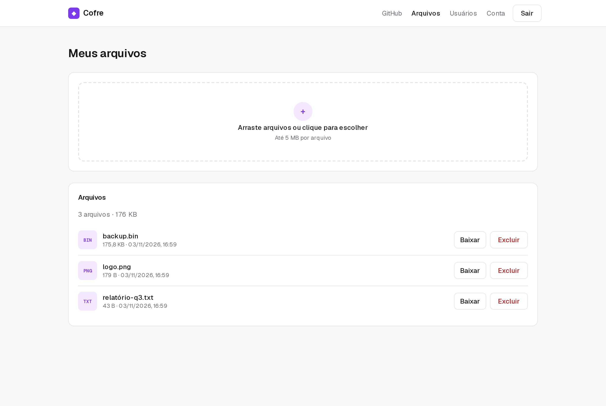
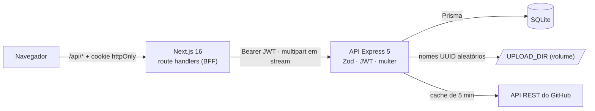
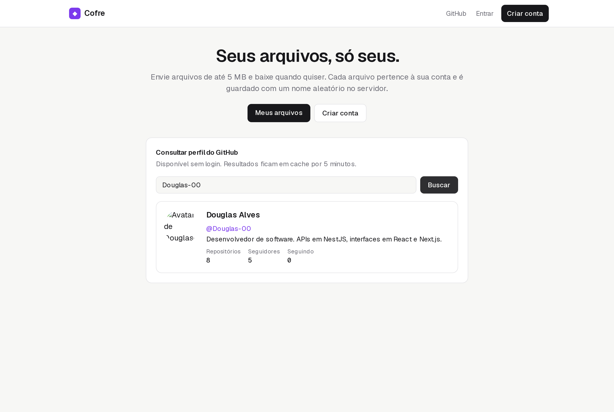
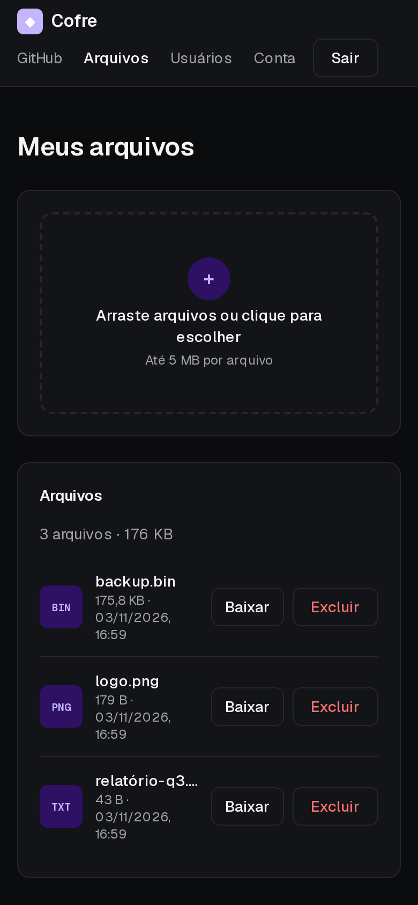

# Cofre: usuários, JWT, arquivos privados e busca no GitHub

[](https://github.com/Douglas-00/ApiRest/actions/workflows/ci.yml)

> 🇺🇸 [Read in English](README.md)

Uma API em **Express 5** + Prisma, sem framework por trás, com frontend em Next.js. O usuário se cadastra, envia arquivos de até 5 MB, baixa quando quiser e consulta perfis do GitHub.

Esta foi minha primeira API REST, de 2023. Mantive o escopo original e **reescrevi no padrão que eu entregaria hoje**. A tabela abaixo mostra o que estava errado e como foi corrigido.



## O que estava errado na versão de 2023

| Problema | Impacto | Correção |
| --- | --- | --- |
| JWT assinado com a string fixa `"secret"` | Qualquer pessoa podia forjar tokens | `JWT_SECRET` vem do ambiente, com 16+ caracteres, validado ao iniciar |
| `PUT` / `DELETE /users/id/:id` **sem autenticação** | Qualquer pessoa editava ou apagava qualquer usuário | Trocado por `/users/me`, protegido por JWT |
| O cadastro devolvia o usuário **com o hash da senha** | O hash vazava para o cliente | `select` explícito, só com campos públicos |
| O login dizia "usuário não encontrado" ou "senha inválida" | Dava para descobrir quais e-mails tinham conta | Mesma mensagem 401 nos dois casos, e o bcrypt roda contra um hash fictício para os dois caminhos levarem tempo parecido |
| O download procurava o arquivo numa pasta diferente da do upload | **O download sempre falhava** | Um único `UPLOAD_DIR`, testado byte a byte |
| O nome salvo ficava `nome.ext.ext`, e os arquivos não tinham dono | Qualquer pessoa baixava o arquivo de outra pelo id | Cada arquivo pertence a um usuário; o dono é verificado e, se não for ele, a resposta é `404` |
| O `prisma/dev.db` estava commitado com e-mails reais | Dados pessoais no git | Removido do versionamento e ignorado (limpar o histórico depende de decisão do dono) |
| Sem validação, testes, lint ou build | — | Zod, Jest + Supertest, ESLint, `tsc` e CI |

## Arquitetura



## Decisões técnicas

**1. O que o usuário envia nunca vira caminho no disco**

- O arquivo é gravado como `UPLOAD_DIR/<uuid>`. O nome original é só um metadado.
- Esse nome é higienizado (`../../evil.sh` vira `evil.sh` e caracteres de controle são removidos) e volta ao usuário pelo `Content-Disposition`.
- O download envia `X-Content-Type-Options: nosniff`.
- O limite de tamanho é aplicado pelo multer durante o envio, não depois.

**2. Arquivo de outra pessoa responde 404**

A resposta é "não encontrado", igual à de um id que não existe, então não dá para sondar ids alheios.

**3. Disco e banco sempre consistentes**

- Se o insert no banco falhar, o arquivo enviado é apagado do disco.
- Excluir um arquivo apaga o registro e o arquivo.
- Excluir a conta remove os registros em cascata e apaga os arquivos do disco.

**4. Busca no GitHub respeitando o limite de requisições**

- Sem token, o GitHub permite 60 requisições por hora por IP. Por isso os perfis ficam em cache por 5 minutos (`X-Cache: HIT/MISS`).
- O nome de usuário é validado com as regras do próprio GitHub antes da chamada.
- Mapeamento de erros: `404` do GitHub → `404`; `403/429` → `503`; outras falhas → `502`.
- O `GITHUB_TOKEN` é opcional.

**5. Injeção de dependência sem framework**

O app é montado por `createApp({ prisma, config, fetch })`. Assim, os testes usam um SQLite real e um `fetch` falso para o GitHub, e o CI não precisa de rede.

**6. Express 5**

Handlers assíncronos repassam erros nativamente. Um único middleware converte erros do Zod, do multer, do Prisma e de domínio em `{ statusCode, message }`, em português.

**7. SQLite de propósito**

A carga é pequena e roda num só nó. SQLite com um volume Docker deixa o projeto sem dependências externas. Migrar para PostgreSQL é trocar o `provider` e gerar novas migrations.

**8. Autenticação no frontend via BFF**

É o mesmo padrão do meu [encurtador de URLs](https://github.com/Douglas-00/Api-EncurtadorURLS):

- o JWT fica num cookie `httpOnly`;
- o `proxy.ts` protege as páginas privadas;
- o proxy repassa uploads multipart em stream (`duplex: "half"`) e devolve os headers de download.

## API

| Método | Rota | Auth | Descrição |
| --- | --- | --- | --- |
| `POST` | `/users` | – | Cadastro |
| `POST` | `/auth/login` | – | Retorna `{ token, expiresIn, user }` |
| `GET` | `/users` | JWT | Lista usuários (sem campos sensíveis) |
| `GET` / `PUT` / `DELETE` | `/users/me` | JWT | Própria conta. Excluir a conta também apaga os arquivos |
| `POST` | `/files` | JWT | Upload multipart no campo `file`, até 5 MB |
| `GET` | `/files` | JWT | Arquivos do usuário |
| `GET` | `/files/:id/download` | JWT | Download com o nome original |
| `DELETE` | `/files/:id` | JWT | Apaga o registro e o arquivo |
| `GET` | `/github/:username` | – | Perfil público do GitHub (com cache) |
| `GET` | `/health` | – | Verifica a aplicação e o banco |

Exemplo de erro de validação:

```json
{
  "statusCode": 400,
  "error": "Requisição inválida",
  "message": [
    "name: name é obrigatório",
    "email: email deve ser um e-mail válido",
    "password: password deve ter no mínimo 8 caracteres"
  ]
}
```

## Como rodar

```bash
docker compose up --build
```

- Web: http://localhost:3001 · API: http://localhost:3000
- O banco e os uploads ficam no volume `cofre-data`. As migrations rodam quando o container sobe.

Desenvolvimento local:

```bash
cp .env.example .env
npm ci && npx prisma migrate deploy && npm run dev   # API na porta 3000
cd web && npm ci && npm run dev                      # web na porta 3001
```

## Testes

| Camada | Ferramentas | Cobertura |
| --- | --- | --- |
| API | Jest + Supertest + **SQLite real** (migrado a cada execução) | um teste de regressão para cada bug acima, upload → download com bytes idênticos, path traversal, limites de tamanho e arquivo vazio, isolamento entre usuários, cascata ao excluir a conta, GitHub (mapeamento, cache e erros) com `fetch` simulado |
| Web | Vitest + Testing Library | validação de arquivos, payload multipart (sem content-type manual), erro por arquivo, confirmação ao excluir, estados da busca no GitHub, atualização de conta com "só o que mudou", `?next=` seguro |

```bash
npm test
cd web && npm test
```

## Telas

| Início com busca no GitHub | Mobile, modo escuro |
| --- | --- |
|  |  |


---

Douglas Alves · [LinkedIn](https://www.linkedin.com/in/douglas-alves-de-souza-b3b901179) · [GitHub](https://github.com/Douglas-00)
